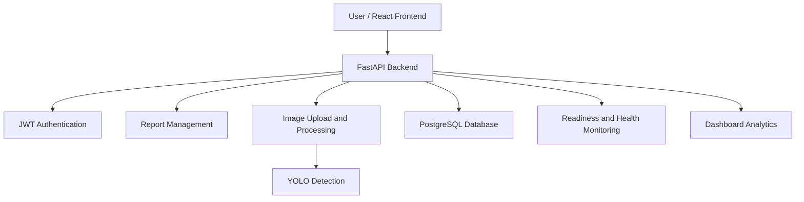

# InfraSentry AI — Portfolio Showcase

## Project Overview

InfraSentry AI is an AI-powered infrastructure monitoring
and image-analysis platform built with FastAPI, Python,
YOLO and PostgreSQL.

## Core Technologies

- Python
- FastAPI
- PostgreSQL
- SQLAlchemy
- JWT Authentication
- YOLO / Ultralytics
- Docker and Docker Compose
- React and TypeScript

## System Architecture

## Implemented Capabilities

1. Authentication and protected API access.
2. Report creation, updates and deletion.
3. Image upload and processing.
4. YOLO model information and detection endpoint.
5. System readiness and health monitoring.
6. Dashboard analytics and report listing.
7. Docker-based backend and PostgreSQL deployment.

## Validation

The recorded end-to-end smoke test checks:
- Backend health
- Admin login and JWT token
- Authenticated profile
- Readiness endpoint
- Report creation and update
- Image upload and accessibility
- AI detection endpoint
- Dashboard analytics
- Report deletion

Note: Detection endpoint execution is validated; detection accuracy
and model performance must be evaluated separately.

## Three-Minute Demo Script

### 0:00–0:30 — Introduction
"Hi, this is InfraSentry AI, an AI-powered infrastructure
monitoring and image-analysis platform."

### 0:30–1:00 — Architecture
"Here is the architecture: React frontend, FastAPI backend,
PostgreSQL database and YOLO-based image detection."

### 1:00–1:40 — Authentication and Reports
"Users can authenticate and manage infrastructure reports
through protected APIs."

### 1:40–2:20 — Image and AI Workflow
"Images can be uploaded and processed. The AI detection
endpoint provides the detection workflow."

### 2:20–2:45 — Dashboard and Monitoring
"The application exposes readiness, health and analytics
endpoints to monitor application workflows."

### 2:45–3:00 — Deployment
"The backend and PostgreSQL database run locally through
Docker Compose with persistent storage."

## Resume-Ready Project Description

**InfraSentry AI | AI-Powered Infrastructure Monitoring Platform**

- Developed a full-stack infrastructure monitoring platform
  with FastAPI, React, PostgreSQL and YOLO.
- Implemented JWT authentication, report management,
  image-upload processing and AI detection APIs.
- Integrated Docker Compose deployment with PostgreSQL,
  persistent volumes and container health checks.
- Built readiness, health-monitoring and dashboard analytics
  workflows, validated through end-to-end API tests.

## Repository

https://github.com/HimpariAgarwal/infrasentry-ai

## Honest Project Status

Local Docker deployment and documented API workflows are tested.
Public cloud deployment, production security certification,
model accuracy benchmarking and scalability testing are not
claimed by this showcase.
